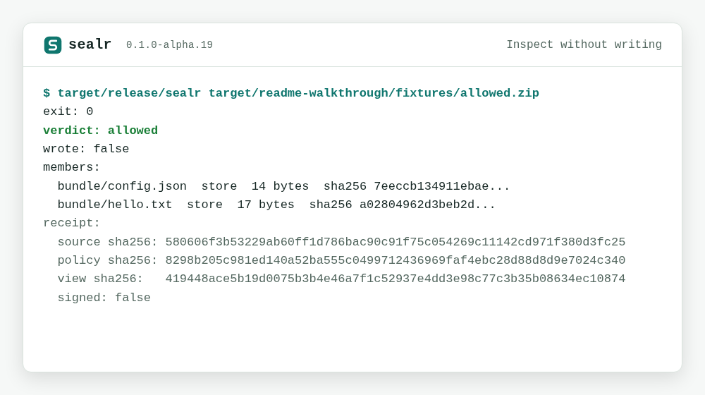

<picture>
  <source media="(prefers-color-scheme: dark)" srcset="docs/assets/brand/sealr-wordmark-dark.svg">
  
</picture>

[](https://github.com/blisspixel/sealr/actions/workflows/ci.yml)

**One archive. One meaning. One verified tree.**

Sealr turns an untrusted archive into a verified, reusable tree capability.
It chooses one explicit interpretation, verifies every member, and returns
an evidence receipt. If verification fails, no tree is published.

Downstream tools consume the `VerifiedArchive` capability or materialized tree.
The original archive can be deleted after admission, so another parser cannot
silently give the same bytes a different meaning.

[Get started](docs/getting-started.md) · [Documentation](docs/index.md) · [Roadmap](ROADMAP.md) · [Releases](https://github.com/blisspixel/sealr/releases)

## Try it

Download the published native Linux, macOS, or Windows archive from
[`v0.1.0-alpha.19`](https://github.com/blisspixel/sealr/releases/tag/v0.1.0-alpha.19)
and [verify the release](docs/release-verification.md) before running it.

```sh
# On a terminal this prints a one-line summary. A pipe or --json keeps JSON.
./sealr path/to/archive.zip

# Publish the verified tree into a new destination.
./sealr path/to/archive.zip --dest ./out
```

ZIP32 is the default. Select ZIP64 explicitly with `--format zip64`.
The destination must be new and its parent must already exist.
Exit `0` means verified, `2` means not admitted, and `3` means a failed destination effect.

To build from source, the repository pins Rust 1.99.1:

```sh
git clone https://github.com/blisspixel/sealr.git
cd sealr
cargo run --locked -p sealr-cli -- path/to/archive.zip
```

The [getting started guide](docs/getting-started.md) covers source builds,
canonical evidence verification, and a Rust example that deletes the source
before evaluating a wheel.

## See it work

Inspecting a two-member ZIP verifies both members without writing a destination:

<picture>
  <source media="(prefers-color-scheme: dark)" srcset="docs/assets/readme-walkthrough/sealr-inspect-allowed-terminal-dark.png">
  <source media="(prefers-color-scheme: light)" srcset="docs/assets/readme-walkthrough/sealr-inspect-allowed-terminal-light.png">
  
</picture>

This image is rendered from the measured view and receipt of this source tree.
On a terminal, the CLI prints a one-line summary. Redirected output and
`--json` keep the JSON. The displayed version matches the receipt.
The [full walkthrough](docs/walkthrough.md) includes parent-path rejection,
materialization, both themes, and reproduction instructions.

## Current status

This source tree targets `v0.1.0-alpha.19`, built with Rust 1.99. A terminal
refusal names the member and the next step. Exit 3 says `not written` when the
destination already exists. `--machine` prints one versioned command result.
Finding-code discriminants are pinned, and `ZipSymlink` is 79. Real bombs
still fail `quota.ratio`, and the default `max_ratio` stays 100. The
[Alpha.19 release notes](docs/releases/v0.1.0-alpha.19.md) describe this source
tree. Published native archives are
[`v0.1.0-alpha.19`](https://github.com/blisspixel/sealr/releases/tag/v0.1.0-alpha.19).
[Release verification](docs/release-verification.md) checksums those published
archives.

Alpha.17 contains machine-readable publisher failures, tested evidence and Rust
consumer migrations, named durability controls, and reproducible assurance
bookkeeping. Native CI covers Linux, macOS, and Windows. The
[Alpha.17 notes](docs/releases/v0.1.0-alpha.17.md) remain that release's record.

Sealr is a development preview for integration and adversarial testing. It has
no independent security audit or stable production release. Receipts are unsigned,
and admission does not establish that a program is safe to execute.
This GitHub-only prerelease does not publish a crate to crates.io.

Alpha.17 starts the current owner-controlled distribution history. Earlier
remote releases and tags are retired; their notes and measurements remain
historical records. See [distribution history](docs/distribution-history.md).

The [implementation and security boundary](docs/implementation.md) describes
supported formats, the explicit Linux worker, resource limits, and open gaps.

## What comes next

Repeated-read phases are recorded in
[repeated-read phases](docs/repeated-read-phases.md). The
[abandoned-stage contract](docs/abandoned-stage.md) is current: a live
operation acts on the retained stage capability, and a later call does not
delete a stage by filename. Failed cleanup on Linux and macOS can return a
separate stage-retention record, and recovery removes that one directory only
when the record is presented again. A caller can ask for that record to be
written to a path while the stage exists; a killed process leaves that file
and no other record. Windows does not record a file identifier. The zip 9.2.2 and Poetry
fixture dependency closure is current. The deferred flate2, lzma, and CRC
closure follows the remaining lifecycle gap. Additional formats remain
deferred. The
[iteration record](docs/autonomous-improvement.md) preserves the historical
artifact pins, exact measurements, and completed migration evidence.

The [roadmap](ROADMAP.md) and [execution plan](docs/near-term.md) use automated
acceptance criteria without human approval or adopter recruitment dependencies.
The owner-maintained [validation project](https://github.com/blisspixel/sealr-validation)
provides real-wheel integration evidence. The optional
[pilot contract](docs/adopter-pilot.md) defines independent adoption separately;
automated conformance does not establish adoption or an independent audit.

## Go deeper

- [CLI usage and formats](docs/usage.md)
- [Rust API and evidence](docs/api.md)
- [Complete Python wheel installation handoff](crates/sealr/examples/pypa_installer_handoff/README.md)
- [Compatibility evidence](docs/wheel-producer-compatibility.md)
- [Security policy](SECURITY.md) and [threat model](docs/threat-model.md)
- [Contributing](CONTRIBUTING.md) and [documentation index](docs/index.md)

[Apache-2.0](LICENSE). Native archives include dependency license notices.
